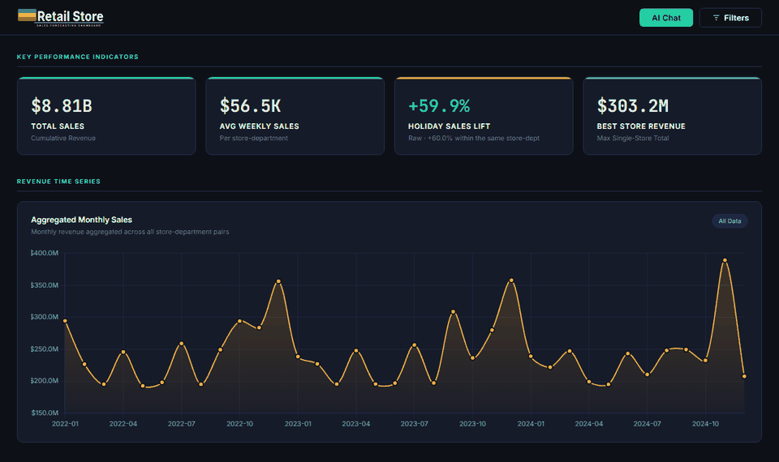
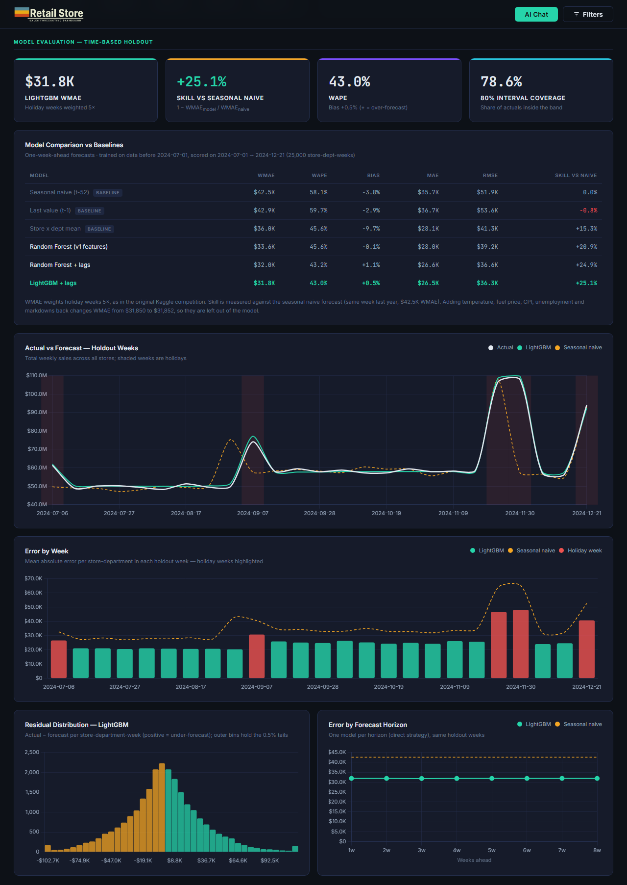
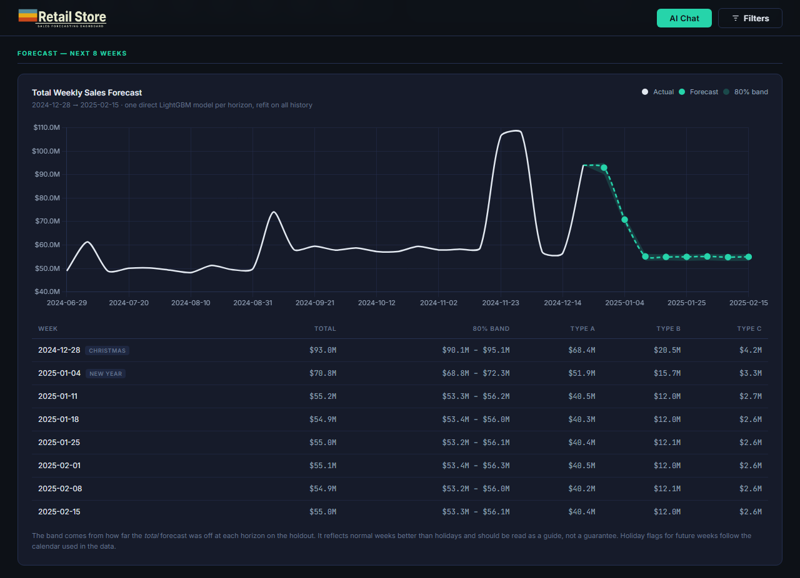

<p align="center">
  
</p>

<h1 align="center">Retail Store: Weekly Sales Forecasting</h1>

<p align="center">
  <a href="https://github.com/pinheiro-dataworks/retail-store/actions/workflows/ci.yml"></a>
  
  
  <a href="LICENSE"></a>
  <a href="https://retail-store-eta.vercel.app"></a>
</p>

<p align="center">
  
</p>

This project forecasts weekly sales for each store and department, 1 to 8
weeks ahead. Every model is validated by date, so it is always tested on
weeks that come after its training data, and it is compared against naive
baselines. An interactive dashboard shows how the models were evaluated and
what they forecast. A small LLM assistant answers questions using only the
precomputed numbers.

**Live demo:** [retail-store-eta.vercel.app](https://retail-store-eta.vercel.app)

---

## Business problem

Store and category managers decide every week how much stock to order and
how many staff to schedule. Ordering too much ties up cash and shelf space;
ordering too little loses sales, and it costs the most in holiday weeks. This
project answers two questions for each store × department:

- **What will next week, and the following seven, look like?**
- **How much can we trust that number?** This is the error against a simple
  baseline and an 80% interval.

## Key results

The table below covers one-week-ahead forecasts on a time-based holdout
(2024-07-01 → 2024-12-21, 25,000 store-department-weeks the models never saw).

| Model | WMAE | WAPE | Bias | Skill vs. naive |
|---|---|---|---|---|
| Seasonal naive, y(t−52) | 42,545 | 58.1% | −3.8% | 0% |
| Store × dept historical mean | 36,023 | 45.6% | −9.7% | 15.3% |
| Random Forest, v1 features | 33,639 | 45.6% | −0.1% | 20.9% |
| Random Forest + lags | 31,965 | 43.2% | +1.1% | 24.9% |
| **LightGBM + lags** | **31,850** | **43.0%** | **+0.5%** | **25.1%** |

**WMAE** weights holiday weeks 5×, as in the original Kaggle competition.
**Skill** = 1 − WMAE / WMAE(seasonal naive).

**What the numbers say**

- **The model beats the seasonal naive by 25%, and the gain is largest in
  holiday weeks.** Holidays shift by a week from year to year, so
  y(t−52) often peaks a week early or late. The model gets the timing right
  from `holiday_name`. In holiday weeks, MAE drops from 51.1K (naive) to 38.6K.
- **The features matter more than the algorithm.** Random Forest and
  LightGBM land within 0.4% of each other once both get store and department
  identity plus a leak-free estimate of each series' level. That estimate
  (`expanding_mean`) is the top feature by permutation importance.
- **The macro columns carry no signal in this dataset.** Temperature, CPI,
  fuel price, unemployment and markdowns behave like random draws each week.
  Adding them back moves WMAE from 31,850 to 31,852. Markdowns appear to
  correlate with sales (r ≈ 0.10), but only because they are about 2× higher
  in holiday weeks. Outside holiday weeks, r ≈ 0.00.
- **WAPE around 43% is close to the floor for this data.** About half of the
  variance in weekly sales is noise around each series' level. Error stays
  flat from 1 to 8 weeks ahead, and the 80% interval covers 78.6% of actuals.

The first version of this project reported MAE 25.6K from a shuffled
`train_test_split`, which let models train on weeks after the ones they were
scored on. Under a proper time-based split, the same models score 28.0K.

## Dataset

This is an **adapted** version of
[Walmart Recruiting — Store Sales Forecasting](https://www.kaggle.com/competitions/walmart-recruiting-store-sales-forecasting),
published on Kaggle by [Noopur Bhatt](https://www.kaggle.com/noopurbhatt). It
is **not** the original Walmart data: the adapted version covers 50 stores ×
20 departments × 156 weeks (2022-01-01 → 2024-12-21) instead of 45 stores and
81+ departments in 2010–2012. Provenance, checksums and known quirks are
documented in [`data/README.md`](data/README.md).

| File | Rows | Grain |
|---|---|---|
| `sales.csv` | 156,000 | store × department × week |
| `stores.csv` | 50 | store (type A/B/C, size, region) |
| `features.csv` | 7,800 | store × week (holidays, season, macro, markdowns) |

## Methodology

1. **Validation by date.** Training runs through 2023, H1 2024 is used for
   early stopping and tuning, and H2 2024 is the test set, scored once.
   Hyperparameters are chosen on expanding-window backtest folds that end
   before the test period.
2. **Leak-free features.** Every history feature for week *t* uses sales up
   to *t − h* only. These are lags `h`, `h+1`, `h+3` and `52`, 4- and
   13-week rolling means, a rolling standard deviation and the expanding mean.
   Store, department, store type, region and holiday name enter as unordered
   categoricals. A unit test multiplies every later sale by 1,000 and checks
   that no feature changes.
3. **Models and baselines.** Three naive baselines (seasonal naive, last
   value, historical mean), Random Forest and LightGBM. Holiday weeks are
   weighted 5× in training to match WMAE.
4. **Uncertainty.** Quantile LightGBM (q10/q90) gives an 80% interval for
   each series. Its coverage is checked on the holdout.
5. **Forecasting.** One model per horizon, *h* = 1…8 (direct strategy), is
   evaluated on the same holdout and then refit on all history to forecast
   2024-12-28 → 2025-02-15.
6. **Explainability.** Permutation importance on the holdout, replacing
   impurity (MDI) importance.

The evidence behind each choice is in
[`notebooks/01_eda.ipynb`](notebooks/01_eda.ipynb). The full write-up is in
the [model card](docs/MODEL_CARD.md).

## Dashboard

| | |
|---|---|
|  |  |

- **KPIs and descriptive views:** revenue over time, by store type and by
  region; holiday and seasonal patterns. Year, region, type and season
  filters update these views.
- **Model evaluation:**
  - comparison table against the baselines
  - actual vs. forecast over the holdout, with holidays shaded
  - error by week
  - residual distribution
  - error by horizon
- **Forecast:** the next 8 weeks with an 80% band and a breakdown by store
  type.
- **Feature analysis:** permutation importance, plus correlations that
  separate out the holiday confounder.

## LLM assistant

The chat runs on Groq (`llama-3.3-70b-versatile`) and uses **grounded
prompting**: the pipeline writes a small JSON of precomputed facts, and the
whole file goes into the system prompt. There is no retrieval step and no
vector store, because the facts fit easily in a single prompt. The model is
told to decline questions the facts cannot answer.

- **API key:** kept server-side (`GROQ_API_KEY`). If it is not set, the page
  falls back to asking the visitor for their own key.
- **Abuse protection:** per-IP rate limit (Upstash Redis or in-memory),
  1,000-character message cap and a CORS allowlist.
- **Tests:** 12 `node:test` tests cover the endpoint.
- **Evaluation:** [`eval/assistant_questions.json`](eval/assistant_questions.json)
  has 13 factual questions and 2 that the assistant should decline.
  `scripts/eval_assistant.py` scores a running deployment against them.

## Limitations and next steps

- **Data.** The dataset is adapted and partly synthetic, so the results do
  not transfer to a real retailer as they are. The exogenous columns being
  noise means this project says nothing about price or promotion effects.
- **Test period.** There is a single test period (H2 2024). A rolling-origin
  evaluation across several years would give a more robust estimate.
- **Holiday calendar.** Holiday flags for future weeks are hard-coded for the
  forecast window.
- **Aggregate band.** The band on total sales comes from 25 holdout weeks per
  horizon, so it is indicative only.
- **Next steps:**
  - hierarchical reconciliation (store → region → total)
  - a global deep-learning baseline, such as N-BEATS
  - scoring the assistant eval in CI against a preview deployment

## Reproducibility

```bash
git clone https://github.com/pinheiro-dataworks/retail-store.git
cd retail-store
make setup                      # pinned Python dependencies + dev tools
make data                       # download (RETAIL_DATASET=<owner>/<slug>) or verify data/raw/
make train                      # ~2.5 min: tune, evaluate, forecast, export to web/data/
make test                       # pytest (Python) + node:test (API)
make serve                      # static preview at http://localhost:8080
```

To run the full app with the chat, use `cd web && npx vercel dev`.
Deployment variables are listed in the
[project manual](docs/PROJECT_MANUAL.md#7-deployment).

## Project structure

```
├── src/retail_forecast/     pipeline package (data, features, models, tuning, forecast, export)
├── tests/                   pytest: metrics, leakage, splits, models, JSON contract, eval sync
├── notebooks/01_eda.ipynb   EDA behind the modelling choices
├── scripts/                 data download + checksum, assistant evaluation
├── eval/                    assistant question set
├── docs/                    model card, project manual, images
├── web/                     Vercel root: static dashboard + /api/chat
│   ├── index.html, css/, js/
│   ├── api/chat.js, api/_lib/
│   ├── data/                generated JSON (committed)
│   └── tests/               node:test suite for the API
├── data/                    raw CSVs (not committed) + provenance
├── Makefile, pyproject.toml, requirements*.txt
└── .github/workflows/ci.yml ruff + pytest + node tests
```

## Author

**Renan Pinheiro**, Data Scientist

[](https://github.com/pinheiro-dataworks)
[](https://www.linkedin.com/in/pinheirodata/)

Released under the [MIT License](LICENSE).
